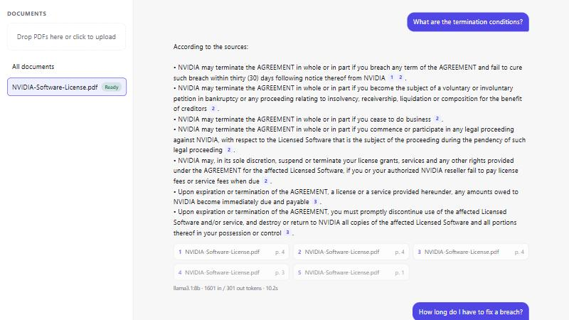
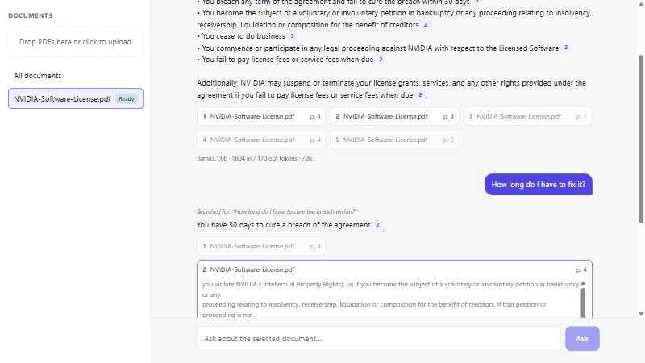
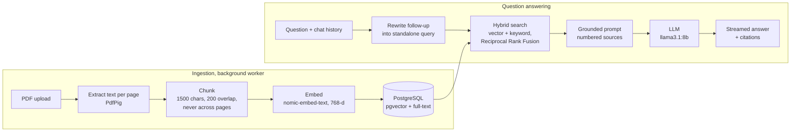

# Document Assistant

**Chat with your PDFs, with answers grounded in the documents and citations to the exact page.**
A Retrieval-Augmented Generation (RAG) application built with **.NET 10, PostgreSQL + pgvector, and
Microsoft.Extensions.AI**, running **fully local and free** on a consumer GPU (or on OpenAI with one config change).



Part of a series on **practical AI engineering for .NET developers**: building real AI applications
with the engineering habits we already have (clean architecture, testing, observability) and showing
every decision along the way.

---

## What it does

1. **Upload PDFs.** Text is extracted, split into chunks, embedded and stored in PostgreSQL, in the background.
2. **Ask questions** in plain language. The answer **streams** in token by token.
3. **Every claim is cited** (`[1]`, `[2]`). Click a citation to see the exact passage and page it came from.
4. **Ask follow-ups** ("how long do I have to fix it?"). The assistant rewrites them into standalone questions before searching.
5. **It says "I couldn't find the answer"** instead of making one up when the documents don't contain it.



## How it works



### Architecture

Clean Architecture as a modular monolith: no microservices, clear boundaries.

| Project | Responsibility |
|---|---|
| `Domain` | `Document` and `DocumentChunk` entities with a guarded status lifecycle (`Uploaded → Processing → Ready / Failed`). No dependencies. |
| `Application` | Use cases: upload, processing pipeline, chunking, retrieval, RAG prompt and answers. Depends only on abstractions (`IEmbeddingGenerator`, `IChatClient`, `IChunkSearch`, …). |
| `Infrastructure` | EF Core + Npgsql + pgvector, hand-written search SQL, PdfPig text extraction, local file storage, background worker, AI provider registration. |
| `Api` | ASP.NET Core controllers, Server-Sent Events streaming, ProblemDetails errors; serves the built React app in Docker. |
| `frontend` | React + TypeScript (Vite): upload, status, streaming chat, citation chips, source cards. |

## Engineering highlights

These are the parts worth talking about, and each one is small enough to read in a few minutes.

- **Provider-agnostic AI with Microsoft.Extensions.AI.** The application depends only on
  `IEmbeddingGenerator` and `IChatClient`. Switching between local Ollama models and OpenAI is a
  config change ([AIServiceCollectionExtensions.cs](src/DocumentAssistant.Infrastructure/AI/AIServiceCollectionExtensions.cs)).
- **768-dimension embeddings for both providers.** OpenAI's `text-embedding-3-small` can shorten its
  vectors (Matryoshka embeddings) to match local `nomic-embed-text`, so one `vector(768)` column fits
  either provider without a schema change.
- **Hybrid retrieval with Reciprocal Rank Fusion.** pgvector cosine search finds meaning, PostgreSQL
  full-text search finds exact terms, and RRF merges the two by rank rather than by incomparable scores
  ([ReciprocalRankFusion.cs](src/DocumentAssistant.Application/Retrieval/ReciprocalRankFusion.cs),
  [PgChunkSearch.cs](src/DocumentAssistant.Infrastructure/Retrieval/PgChunkSearch.cs)).
- **Grounding against hallucination.** Numbered sources, an explicit "not found" reply, temperature 0,
  and no LLM call at all when retrieval finds nothing ([RagPrompt.cs](src/DocumentAssistant.Application/Rag/RagPrompt.cs)).
- **Follow-up questions via query rewriting.** A follow-up is condensed into a standalone question
  before retrieval, and the UI shows what was actually searched.
- **Chunks never span pages,** so every citation points to exactly one page.
- **Model-specific details handled.** nomic-embed-text's `search_document:` / `search_query:` task
  prefixes are configurable.
- **Streaming with .NET 10's `TypedResults.ServerSentEvents`.** The React client parses SSE from a
  POST response with `fetch`, since `EventSource` only supports GET ([api.ts](frontend/src/api.ts)).
- **Background ingestion** with a `Channel<T>` queue and a `BackgroundService`, with startup recovery
  for documents interrupted by a restart.
- **Cost and latency visibility.** Token usage, estimated embedding cost and answer latency are
  reported per document and per answer.
- **Tests that don't need a GPU or an API key.** About 180 tests: unit tests with fakes, plus
  integration tests against real PostgreSQL via **Testcontainers**, with an offline hashing
  embedding model and a fake chat model.

## Results on a real document

Measured on a 6-page software license agreement (27 chunks), on an RTX 4060 Ti.

**Retrieval: which mode puts the right passage first?**

| Question | Vector | Keyword | Hybrid |
|---|---|---|---|
| "Can I use beta software in production?" | ✅ Pre-release licenses | ❌ matched the word "use" | ✅ |
| "Which state's law governs this agreement?" | ✅ | ✅ | ✅ |
| "What happens if I break the terms?" | ✅ Term and termination | ❌ matched the word "terms" | ✅ |
| "GPU" (not in the document) | ⚠️ still returns chunks | ✅ nothing | ⚠️ |

Vector search always returns *something*, which is why the answer step must be allowed to say
"I couldn't find the answer". It did, for the GPU question.

**Answers (llama3.1:8b, local):** 1–4 s per answer once the model is warm (the first request loads
the model into GPU memory). Embedding the whole document took 7,344 tokens, at a cost of $0.

## Run it

### Option 1: everything in Docker

Requires Docker with GPU support (NVIDIA Container Toolkit; Docker Desktop on Windows includes it).

```bash
docker compose up -d --build
```

Open **http://localhost:8080** and upload a PDF. The first start downloads the AI models (~5 GB) and
can take several minutes; check progress with `docker compose logs -f ollama-models`.

### Option 2: development

Requires the .NET 10 SDK, Node.js and Docker.

```bash
# PostgreSQL with pgvector
docker run -d --name document-assistant-db -p 5432:5432 -e POSTGRES_DB=documentassistant -e POSTGRES_USER=appuser -e POSTGRES_PASSWORD=<choose-one> pgvector/pgvector:pg17-bookworm

# Local AI models (Ollama on the GPU)
docker compose up -d ollama ollama-models

# Connection string with your password (kept out of the repo)
dotnet user-secrets set "ConnectionStrings:DocumentAssistant" "Host=localhost;Port=5432;Database=documentassistant;Username=appuser;Password=<choose-one>" --project src/DocumentAssistant.Api

# Database schema, then the API (http://localhost:5056)
dotnet tool restore
dotnet ef database update --project src/DocumentAssistant.Infrastructure --startup-project src/DocumentAssistant.Api
dotnet run --project src/DocumentAssistant.Api --launch-profile http

# Frontend (http://localhost:5173), in another terminal
cd frontend && npm install && npm run dev
```

### Using OpenAI instead of local models

Set the provider to `OpenAI` in `appsettings.json` (the default outside Development) and add your key:

```bash
dotnet user-secrets set "Embeddings:ApiKey" "<your-key>" --project src/DocumentAssistant.Api
dotnet user-secrets set "Chat:ApiKey" "<your-key>" --project src/DocumentAssistant.Api
```

Re-process existing documents after switching embedding models, since vectors from different models aren't comparable.

## API

| Method | Endpoint | Purpose |
|---|---|---|
| `POST` | `/api/documents` | Upload a PDF (multipart, field `file`) |
| `GET` | `/api/documents` · `/api/documents/{id}` | List / get documents and their status |
| `GET` | `/api/documents/{id}/text` · `/chunks` | Inspect extracted text and stored chunks |
| `POST` | `/api/documents/{id}/process` | Retry a failed document |
| `GET` | `/api/search?q=&mode=vector\|keyword\|hybrid` | Retrieval only, with each method's rank |
| `POST` | `/api/ask` | Answer with citations, sources, token usage |
| `POST` | `/api/ask/stream` | Same, streamed as Server-Sent Events |

Examples are in [DocumentAssistant.Api.http](src/DocumentAssistant.Api/DocumentAssistant.Api.http).

## Tests

```bash
dotnet test
```

Integration tests start a throwaway PostgreSQL + pgvector container with Testcontainers, so Docker
must be running. No GPU, model or API key is needed.

## Tech stack

.NET 10 · ASP.NET Core · Entity Framework Core · PostgreSQL 17 · pgvector · Microsoft.Extensions.AI ·
Ollama (llama3.1:8b, nomic-embed-text) · OpenAI (optional) · PdfPig · React 19 · TypeScript · Vite ·
xUnit · Testcontainers · Docker

## Scope

This is a proof of concept built to demonstrate RAG engineering, not a production service. It has no
authentication or multi-tenancy, uses an in-process queue (single instance), stores files on local disk,
and doesn't OCR scanned PDFs. Each of those is a clear, swappable seam in the architecture.
